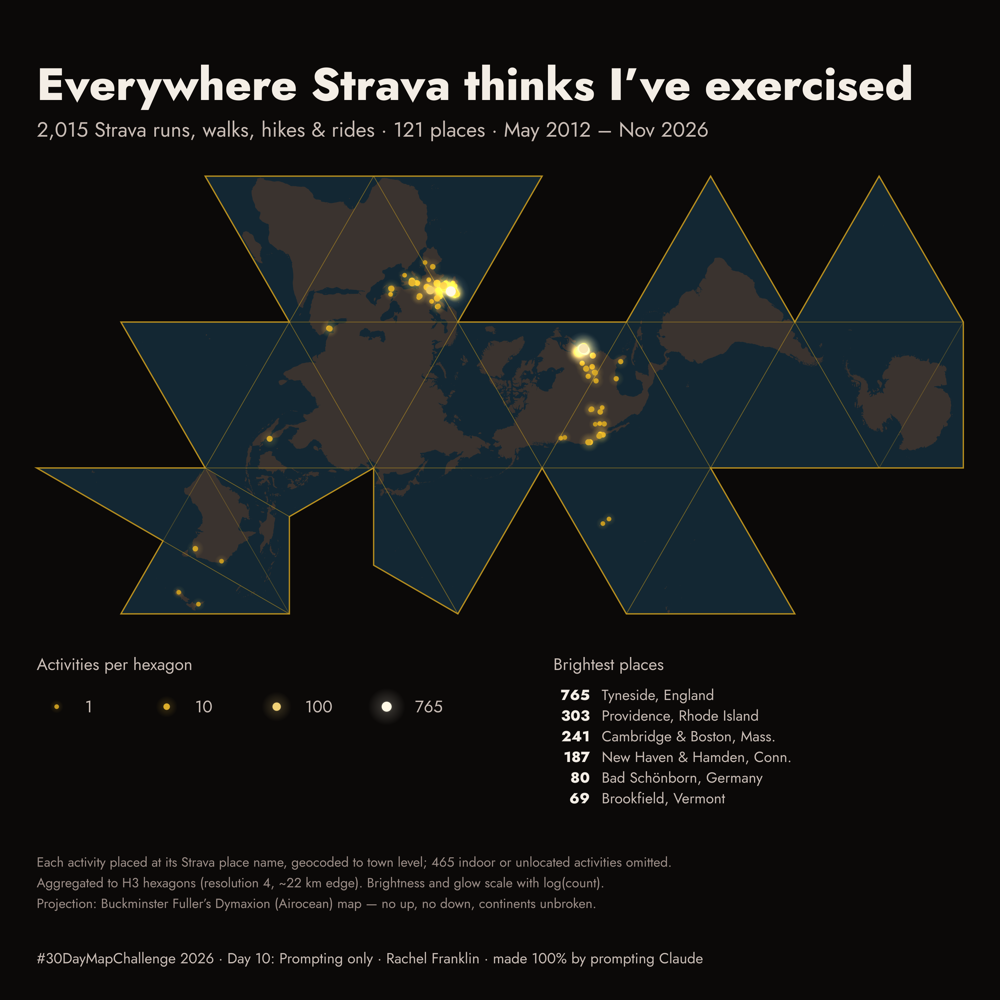

# #30DayMapChallenge 2026

Rachel Franklin's maps for the [#30DayMapChallenge](https://30daymapchallenge.com/) in November 2026.
Each day lives in its own folder with its code, data and notes.

| Day | Theme | Map | Folder |
|---|---|---|---|
| 10 | Prompting only | Everywhere Strava thinks I've exercised: every Strava activity, 2012–2026, on Fuller's Dymaxion projection. Made 100% by prompting Claude ([chat](day10_prompting/CHAT.md)). | [`day10_prompting/`](day10_prompting/) |

