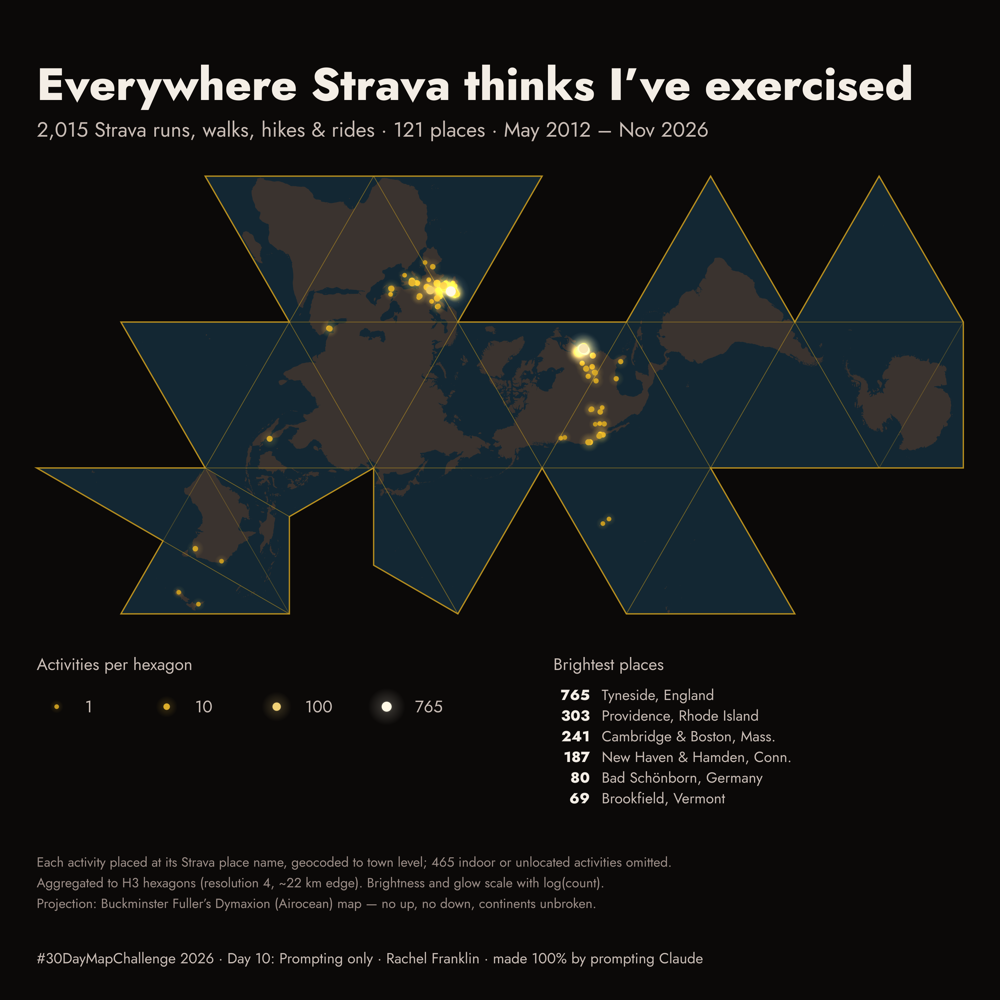

# Everywhere Strava thinks I’ve exercised — #30DayMapChallenge 2026, Day 10 ("Prompting only")

Every geo-located Strava activity Rachel Franklin recorded from May 2012 to November 2026 (2,015 of 2,480),
aggregated to H3 hexagons and drawn as glows on Buckminster Fuller's Dymaxion (Airocean) projection.
The map was made entirely by prompting Claude.

**The conversation:** [original chat in Claude](https://claude.ai/share/c37f1222-44bb-4378-8a37-824269326783) · [`CHAT.md`](CHAT.md) has the full chat text; [`PROMPTS.md`](PROMPTS.md) has Rachel's prompts alone.



## Contents

| Path | What it is |
|---|---|
| `output/day10_prompting_strava_dymaxion.png` | The map, 3000 × 3000 px |
| `CHAT.md` | The full conversation with Claude |
| `PROMPTS.md` | Every prompt, verbatim |
| `01_geocode.py` | Place names → coordinates (offline gazetteer + an auditable hand-coded list) |
| `02_render.mjs` | H3 aggregation and rendering (Node: d3-geo-polygon, h3-js, node-canvas) |
| `data/activities.csv` | All 2,480 activities: id, local start time, sport, Strava place name, trainer flag |
| `data/places.csv` | 121 place names with activity count, coordinates, and how each was geocoded |
| `data/cells.csv` | 98 H3 cells with counts and the places merged into each |
| `fonts/` | Jost 400/800 (SIL Open Font License), converted to TTF for node-canvas |
| `package.json`, `package-lock.json` | Node dependencies |

## Reproduce

```bash
pip install reverse_geocoder        # bundles the GeoNames cities1000 table used as the gazetteer
npm install
python3 01_geocode.py               # writes data/places.csv
node 02_render.mjs                  # writes data/cells.csv and output/…png
```

## Method

1. **Data.** Pulled through the Strava connector (Claude's MCP integration) by a sub-agent paging through
   `list_activities`. The connector returns a place name per activity (e.g. "Cambridge, Massachusetts"),
   not coordinates. 465 activities had no place (treadmill, indoor or no GPS) and are omitted.
   *Data-quality note:* the sub-agent transcribed the first 800 rows (2012–~2015) by hand rather than parsing
   them. Two spot checks against Strava (all Melbourne and Bremen activities, 10 rows) matched exactly on
   id, timestamp and place.
2. **Geocoding.** 57 place names matched GeoNames cities1000, constrained to the correct US state or
   country. The other 64 (national parks, counties, districts, small towns, one bare "Denmark") have
   hand-assigned representative points, all listed in `MANUAL` in `01_geocode.py`. At world scale, town-level
   precision is indistinguishable from GPS start points, and it never exposes a home address.
3. **Aggregation.** H3 resolution 4 (~22 km edge), which merges a metro area (Cambridge + Somerville + Boston;
   Tyneside + Newcastle) while keeping separate towns apart. H3 cells are near-equal-area on the sphere, so
   counts are comparable everywhere.
4. **Symbolisation.** Brightness, colour and glow radius scale with log(count), so 765 activities on Tyneside
   don't wash out a single run in Queenstown. Every occupied cell gets a minimum 7 px core and 20 px halo so
   one-off places stay visible. Halos blend additively.
5. **Projection.** `d3.geoAirocean` (Fuller's own name for the Dymaxion map). Its net is ~2.1:1, so in the
   square frame it fills the middle band; title, legend and notes use the space above and below.

## Colour and contrast

Northumberland v1.0 palette inverted onto near-black, with each choice checked by WCAG contrast ratio
against the background (`#0B0908`):

| Role | Colour | vs background |
|---|---|---|
| 1 activity | mustard `#C49820` | 7.4 : 1 |
| mid | gold `#E8B830` | 10.7 : 1 |
| max (765) | cream `#FFF8E6` | 18.8 : 1 |
| water (inside the net) | slate blue `#132733` | 1.2 : 1, separates the net from the page by hue |
| land | warm grey-brown `#3A332F` | 1.3 : 1 against water, plus a blue/brown hue split; mustard points 4.6 : 1 on land |
| Dymaxion net | mustard `#C49820`: outer edge 4 px at 90%, fold lines 2 px at 35% | |

Clay `#C4704A` (5.5 : 1) was dropped as the low end of the ramp because it was the weakest link.
The net is drawn in the same mustard as the activities so the projection reads as part of the design.
Fold lines are the projection's 24 face triangles; an edge is skipped if it crosses a cut in the net.
Text is Jost 800 / 400, lifted to cream and light warm grey for legibility on black.

## Sources and credits

- Activities: Strava, via the Strava connector, retrieved 10 Nov 2026
- Gazetteer: GeoNames cities1000 (CC BY 4.0), via `reverse_geocoder`
- Land: Natural Earth 1:50m, via `world-atlas`
- Hexagons: Uber H3
- Fonts: Jost by Owen Earl (SIL OFL 1.1)
